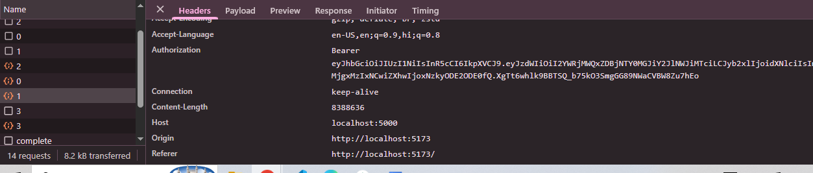
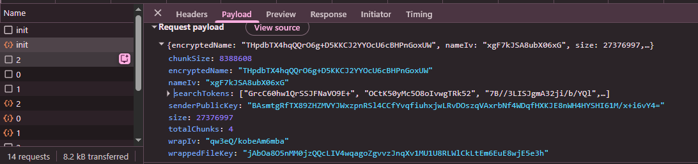
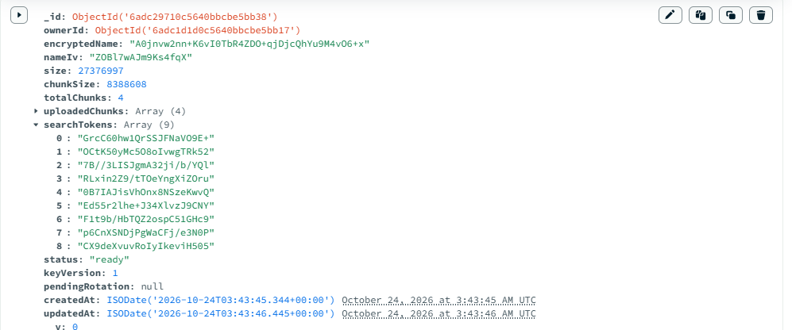
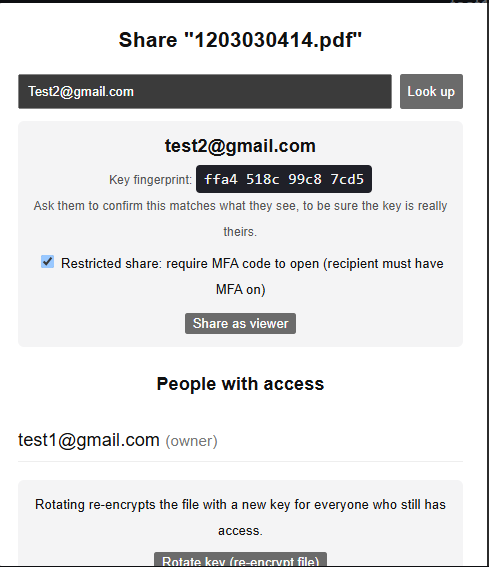
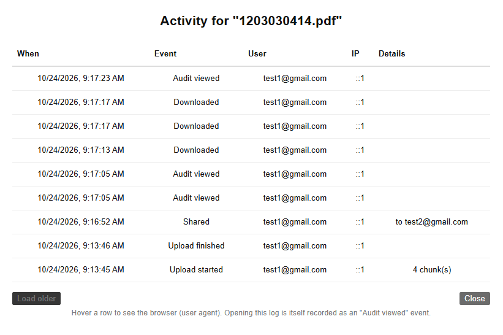
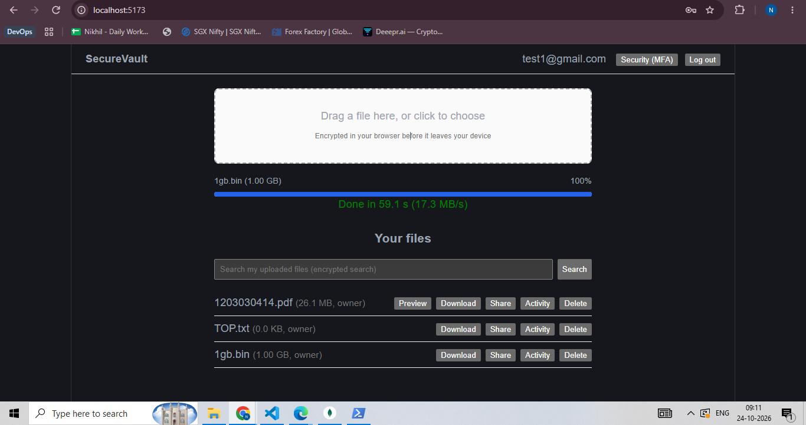

# SecureVault: zero-knowledge encrypted file sharing

SecureVault is a Dropbox-style file sharing app where files are encrypted **in the browser** before upload.
The server and its admins only ever store ciphertext, wrapped keys and metadata. They cannot read your files.

**Stack:** React (Vite) + Web Crypto API, Node.js/Express, MongoDB, local-disk storage.

---

## 1. How to run

**Requirements:** Node 20+, MongoDB running locally, Chrome or Edge.

```bash
# Backend
cd backend
cp .env.example .env        # then edit the values
npm install
npm run dev                 # API on http://localhost:5000

# Frontend (new terminal)
cd frontend
npm install
npm run dev                 # UI on http://localhost:5173
```

`backend/.env`:

| Variable | Meaning |
|---|---|
| `PORT` | API port (5000) |
| `MONGO_URI` | MongoDB connection string |
| `JWT_SECRET` | Long random string; signs login and MFA tokens |
| `STORAGE` | `local` (default) |
| `CLIENT_ORIGIN` | Frontend URL allowed by CORS (`http://localhost:5173`) |

---

## 2. Features (assignment checklist)

| Requirement | Status | Where |
|---|---|---|
| Client-side AES-256-GCM encryption (Web Crypto) | Done | `frontend/src/crypto/fileCrypto.js`, `uploads.js` |
| Chunked upload for 1 GB+ files (8 MB chunks, 3 in parallel, per-chunk retry) | Done | `frontend/src/uploads.js`, `backend/src/routes/files.js` |
| Streaming storage on the server | Done (local disk) | `backend/src/storage/LocalDriver.js` |
| ACL engine with RBAC (`owner`, `viewer`) | Done | `models/Acl.js`, `middleware/acl.js` |
| JWT authentication on every file route | Done | `middleware/auth.js` |
| Key sharing with ECDH P-256 + HKDF + AES-GCM | Done | `frontend/src/crypto/keys.js`, `routes/share.js` |
| Password-derived keys (PBKDF2 600,000 iterations) | Done | `frontend/src/crypto/keys.js` |
| Revocation with cascade and key rotation | Done | `routes/share.js` (`/rotate/*`), `frontend/src/rotate.js` |
| Audit trail `/audit/:fileId` | Done | `routes/audit.js` |
| Drag-and-drop UI and client-side encrypted PDF preview | Done | `components/Upload.jsx`, `PdfPreview.jsx` |
| MongoDB sharding by user | Script provided | `backend/src/scripts/shard.mongosh.js` |
| **Bonus:** MFA (TOTP) for restricted shares | Done | `routes/mfa.js`, `middleware/acl.js` |
| **Bonus:** Encrypted search | Done (blind index, see section 4.8) | `frontend/src/crypto/search.js`, `POST /files/search` |

---

## 3. Evidence (screenshots)

### 3.1 Encrypted on the network
The upload request for each file chunk. `Content-Length` is **8,388,636 bytes**, which is one 8 MB chunk
(8,388,608) plus 28 bytes: a 12-byte random IV and a 16-byte AES-GCM tag. Unencrypted data would be exactly 8,388,608.
The payload is binary ciphertext.



The `init` request and the network view of an upload. Only an encrypted filename, a wrapped file key and hashed
search tokens are sent. No real filename and no raw key.



### 3.2 What the server stores
The MongoDB `files` record. The name is ciphertext (`encryptedName`), search words are opaque tokens, and no file key
or plaintext appears. The server only sees size, chunk count and timestamps.



### 3.3 Sharing
Sharing wraps the file key for the recipient with ECDH. The server stores only the wrapped copy. A key fingerprint is
shown so the two people can confirm the public key was not swapped.



### 3.4 Audit log
Every access is logged with time, user, IP and details, including denied attempts.



### 3.5 Performance: 1 GB upload
Target: a 1 GB upload completes in under 5 minutes.

**Result: a 1 GB file uploaded in 59.1 seconds (about 17.3 MB/s), roughly 5x faster than the 5-minute target.**



| Machine / browser | File | Time | Speed | Result |
|---|---|---|---|---|
| FILL IN (CPU, RAM, Chrome version) | 1 GB (1,073,741,824 bytes) | 59.1 s | ≈ 17.3 MB/s | PASS (under 300 s) |

Integrity check: the SHA-256 of the original file and of the downloaded copy matched (`certutil -hashfile <file> SHA256`).

Memory use stays low because only about three 8 MB chunks are in memory at once. The whole file is never loaded.
Downloads over 200 MB stream straight to disk in Chrome and Edge.

---

## 4. Detailed security audit notes

### 4.1 Threat model
| Who | Can they read files? |
|---|---|
| Server operator or admin | No: only ciphertext, wrapped keys and metadata |
| Attacker who steals the database or disk | No: needs each user's password to unlock keys |
| Someone on the network | No: data is encrypted before it leaves the browser |
| Another logged-in user | No: the ACL check rejects them |
| A user who was revoked | No new access; rotation also invalidates any key they saved |

### 4.2 Key hierarchy and why
```
password --PBKDF2-SHA256 (600k iterations, per-user salt)--> master key
master key --HKDF--> authKey   (sent to server; bcrypt-hashed again there)
           --HKDF--> wrapKey   (never leaves the browser; wraps the private key)
           --HKDF--> searchKey (never leaves the browser; HMAC key for search)
each file: random AES-256 file key  --wrapped per user via ECDH P-256 + HKDF + AES-GCM-->
```
- **Why split the password into three keys:** the server gets `authKey` to verify logins but can never derive
  `wrapKey`, so a database leak does not expose private keys. Using HKDF with different labels keeps the keys independent.
- **Why PBKDF2 at 600,000 iterations:** it makes guessing a password offline slow. The salt is unique per user.
- **Why a random key per file:** a leak of one file key exposes only that file.
- **Why ECDH for sharing:** two people can derive a shared secret from public keys alone, so no password or key
  is ever exchanged through the server.
- **Why AES-256-GCM:** it encrypts and also authenticates, so any change to the data is detected.
- **Private key handling:** it is stored wrapped on the server, unlocked only in the browser, and imported as
  **non-extractable**, so page code can use it but cannot read it back out.

### 4.3 Chunk integrity
Each chunk is encrypted with a fresh random 12-byte IV, and the chunk index and total count are bound in as
authenticated data. A malicious server therefore cannot reorder, swap, duplicate or truncate chunks without
decryption failing. Tested: a flipped byte in a stored chunk makes download fail with a decryption error.

### 4.4 Access control (ACL)
- Every file route requires a valid JWT (HS256 pinned, 1-hour expiry). Missing or invalid token returns **401**.
- `requireAccess` checks for an un-revoked ACL row with an allowed role. Otherwise it returns **403**.
- The same 403 is returned for "file does not exist" and "not yours", so file ids cannot be probed.
- Denied attempts are written to the audit log.
- Roles: `owner` (upload, share, revoke, rotate, delete, view audit) and `viewer` (download only).
- Deleting a file revokes every ACL entry (cascade) and removes the stored chunks.
- File ids and part numbers are validated twice (route and storage driver) to prevent path traversal.

### 4.5 Revocation and key rotation
Revoking removes a user's server-side access immediately, but a user who already saved the file key could still
decrypt a copy they downloaded earlier. To handle this the owner can **rotate the key**:
1. The owner's browser downloads each chunk, decrypts it with the old key, and re-encrypts it with a brand-new key.
2. New chunks are uploaded to a staging area, not the live location.
3. The server swaps them in only after every chunk is present and the access list is unchanged.
4. New wrapped keys are stored for the remaining users and `keyVersion` increases.

After rotation, a key saved earlier no longer opens the stored ciphertext. Verified by comparing SHA-256 of a chunk
before and after rotation.

### 4.6 Authentication and abuse protection
- Login rate limit (30 requests per 15 minutes) and a global rate limit.
- Login takes the same time for unknown emails (dummy hash) and returns a fake salt for unknown emails, so accounts
  cannot be enumerated.
- `helmet` security headers, restricted CORS origin, 1 MB JSON body limit, and errors that never leak stack traces.
- Upload parts have a strict byte limit enforced while streaming, and each part is written atomically (temp file then rename).
- The login token and all keys live only in browser memory, never in localStorage, sessionStorage, IndexedDB or
  cookies. Refreshing the page logs the user out.

### 4.7 MFA for restricted shares (bonus)
- TOTP (RFC 6238) with an authenticator app. The secret is encrypted at rest (AES-256-GCM).
- The owner can mark a share as "Require MFA", and the recipient must have MFA enabled.
- Access to that file's metadata and chunks needs an `X-MFA-Token`, a 10-minute token tied to the user, obtained after a valid code.
- The server enforces this, not only the UI (a request without the token returns 401 with `mfaRequired: true`).
- Code attempts are limited to 10 per 5 minutes per user. MFA events are written to the audit log.

### 4.8 Encrypted search (bonus): what it is and is not
Filename words (and their 3 to 12 letter prefixes) are turned into `HMAC-SHA256(searchKey, word)` tokens in the browser.
The server stores and matches only those tokens, so it never learns filenames or search terms.

This is **searchable symmetric encryption (a blind index)**, not fully homomorphic encryption. Fully homomorphic
search is far too slow for files of this size. Known leakage: the server can see which files share a token and which
files each query matches. Search covers the files a user uploaded, because the search key is per user.

### 4.9 Storage: local disk instead of Amazon S3
The assignment allows "Amazon S3 or a local disk simulation". 

**Note:** S3 support is implemented (`S3Driver.js`), but because of server and hosting cost (Amazon S3 needs a paid
AWS account), the files in this project are stored on local disk (`STORAGE=local`). Both storage drivers share one
interface, so switching to S3 only needs the `STORAGE` setting and AWS credentials, with no change to the rest of the
code. The S3 driver needs `@aws-sdk/client-s3`, `@aws-sdk/lib-storage` and an S3 bucket or MinIO. It has not been
tested against a live bucket.

### 4.10 MongoDB sharding by user
`backend/src/scripts/shard.mongosh.js` shards by user. It must be run against a `mongos` router, and on a plain
standalone MongoDB it prints a message and exits.

| Collection | Shard key | Reason |
|---|---|---|
| `files` | `{ ownerId, _id }` | A user's files are stored together |
| `acls` | `{ userId, fileId }` | A user's access entries are stored together. The unique index starts with the shard key. |
| `auditevents` | `{ fileId: hashed }` | Read per file; hashing avoids a hot shard |
| `users` | not sharded | Small, and needs a globally unique email |

Trade-off: queries by `fileId` alone on `acls` (share list, revoke all) are sent to every shard.
Status: script provided; not run on a cluster.

### 4.11 Known limitations (honest list)
- **Public key substitution:** the server hands out public keys, so a malicious server could substitute one. The
  fingerprint shown when sharing lets two people verify it out of band.
- **Revocation cannot undo a download:** a user who already saved the decrypted file keeps it. Rotation protects future access only.
- **Lost password means lost data.** There is no recovery by design.
- **Metadata is visible:** the server can see file size, chunk count, timestamps, who shared with whom, and search token patterns.
- **MFA gates the file data, not the key list:** a viewer's wrapped key appears in the file list, but it is useless
  without the ciphertext chunks and the viewer's private key.
- **The audit log is append-only by convention** and is not tamper-evident (no hash chain).
- **No upload resume after a page refresh.** Failed chunks are retried up to 3 times, but a refresh restarts the upload.
- **Script injection (XSS):** an attacker who runs script in the page while the user is logged in could use in-memory keys.
  The app avoids third-party scripts and stores nothing in browser storage.

---

## 5. How to test

1. Register three users (`test1` owner, `test2` recipient, `test3` stranger).
2. **Encryption:** upload a text file; in DevTools Network the chunk `Content-Length` is file size + 28 and the payload is binary.
   `findstr /s /m "SOMETEXT" backend\uploads\*` finds nothing.
3. **ACL:** with test3's token, `curl.exe -i -H "Authorization: Bearer <token>" http://localhost:5000/files/<id>/parts/0`
   returns 403, and no token returns 401.
4. **Sharing and roles:** share to test2; test2 can download but cannot delete, share or view the audit log.
5. **Revoke and rotate:** revoke test2, rotate the key, and compare the chunk SHA-256 before and after (it changes).
6. **Integrity:** flip one byte in a stored `.bin` chunk; download fails with a decryption error.
7. **Audit:** open Activity on a file to see uploads, shares, denials and rotations.
8. **MFA:** enable MFA for test2, share with "Require MFA"; without a code the API returns 401 `mfaRequired`.
9. **Search:** upload `Secret-Contract_2026.pdf`, search `contr`; the payload contains only opaque tokens.
10. **Speed:** upload a 1 GB file and record the time shown (see section 3.5). Our result: 59.1 s.

Built-in crypto self-test: `cd frontend && node selfTestRun.mjs` prints PASS lines for key derivation, wrapping,
tamper detection and chunk reordering.